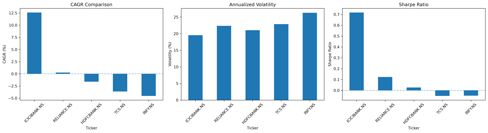

# Indian Stock Market Data Analysis

A Python-based financial data analysis project that explores historical stock market data, evaluates investment performance, measures volatility, and compares risk-adjusted returns across five major Indian companies.

## Project Overview

This project analyses approximately five years of historical stock market data (November 2021 – October 2026) for five major companies listed on the National Stock Exchange of India (NSE).

The objective is to understand how different stocks perform over time and evaluate their returns relative to the risks involved.

## Companies Analysed

| Company | NSE Ticker |
|---|---|
| Reliance Industries | RELIANCE.NS |
| Tata Consultancy Services | TCS.NS |
| Infosys | INFY.NS |
| HDFC Bank | HDFCBANK.NS |
| ICICI Bank | ICICIBANK.NS |

## Features

- Historical stock data collection using Yahoo Finance.
- Data cleaning and preprocessing.
- Daily percentage return calculation.
- Investment growth simulation with an initial investment of ₹100.
- Annualized return and volatility analysis.
- Compound Annual Growth Rate (CAGR) calculation.
- Sharpe Ratio calculation.
- Risk vs. return comparison.
- Stock performance visualizations.

## Dashboard Preview



## Technologies Used

- Python
- Pandas
- NumPy
- Matplotlib
- Seaborn
- yfinance
- Jupyter Notebook

## Key Findings

Based on the historical dataset and the analysis performed:

| Stock | CAGR | Annualized Volatility |
|---|---:|---:|
| ICICI Bank | 12.59% | 19.56% |
| Reliance Industries | 0.27% | 22.35% |
| HDFC Bank | -1.61% | 21.06% |
| TCS | -3.63% | 22.87% |
| Infosys | -4.53% | 26.30% |

### Investment Growth Comparison

An initial investment of ₹100 was simulated for each stock using daily returns.

| Stock | Final Value |
|---|---:|
| ICICI Bank | ₹180.79 |
| Reliance Industries | ₹101.35 |
| HDFC Bank | ₹92.24 |
| TCS | ₹83.15 |
| Infosys | ₹79.33 |

ICICI Bank delivered the strongest performance among the five stocks during the analysed period, while Infosys experienced the highest volatility.

## Risk Analysis

Risk was evaluated using annualized volatility, while risk-adjusted performance was evaluated using the Sharpe Ratio.

The Sharpe Ratio was calculated assuming a 0% annual risk-free rate for this exercise.

**Note:** These results are based on historical adjusted prices and do not guarantee future performance. Transaction costs, taxes, dividends beyond price adjustments, and benchmark-relative performance are not separately modelled.

## Project Structure

```text
stock-market-analysis/
│
├── data/
│   ├── raw/
│   └── processed/
│
├── notebooks/
│   └── 01_data_collection.ipynb
│
├── src/
│
├── visualizations/
│   └── stock_performance_dashboard.png
│
├── README.md
└── requirements.txt
```

## Installation and Setup

### 1. Clone the repository

```bash
git clone https://github.com/pawan646435/stock-market-analysis.git
cd stock-market-analysis
```

### 2. Create a virtual environment

```bash
python3 -m venv venv
```

### 3. Activate the environment

macOS / Linux:

```bash
source venv/bin/activate
```

Windows:

```bash
venv\Scripts\activate
```

### 4. Install dependencies

```bash
pip install -r requirements.txt
```

### 5. Launch Jupyter Notebook

```bash
jupyter notebook
```

Open `notebooks/01_data_collection.ipynb` to explore the analysis.

## Future Improvements

- Add Nifty 50 benchmark comparison.
- Implement technical indicators such as RSI, MACD and moving averages.
- Add portfolio optimization and asset allocation.
- Develop an interactive dashboard using Streamlit.
- Integrate additional stocks and market sectors.

## Author

**Pawan Kumar**

GitHub: [@pawan646435](https://github.com/pawan646435)

---

*This project is intended for educational and analytical purposes, not as investment advice.*